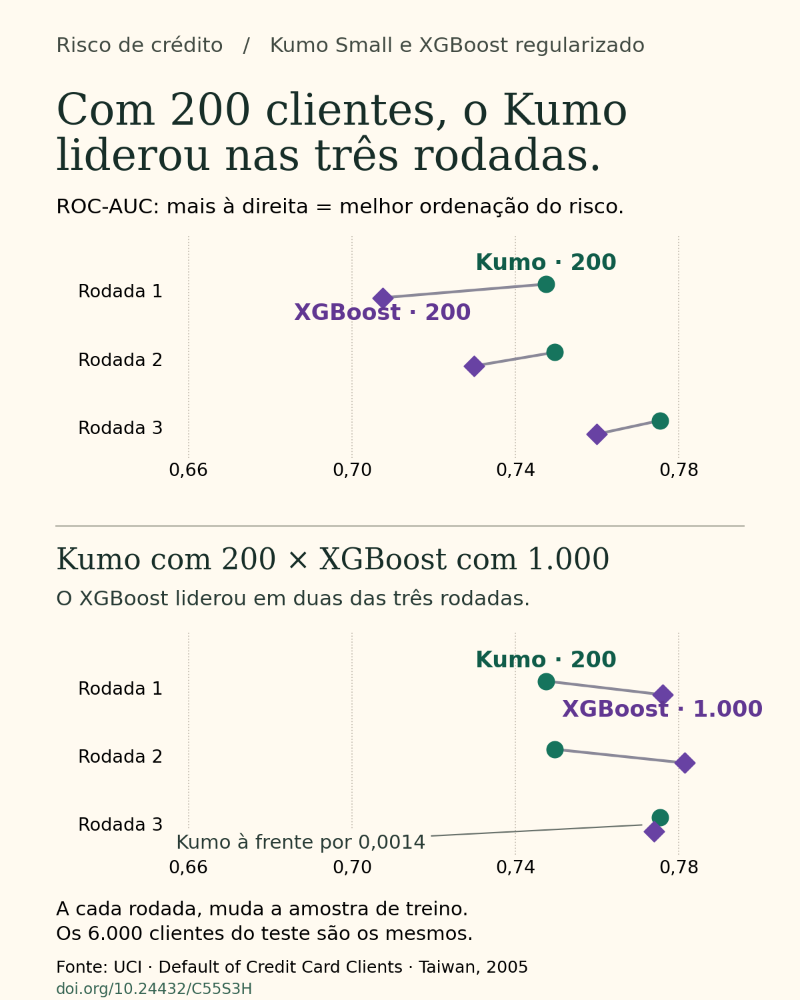
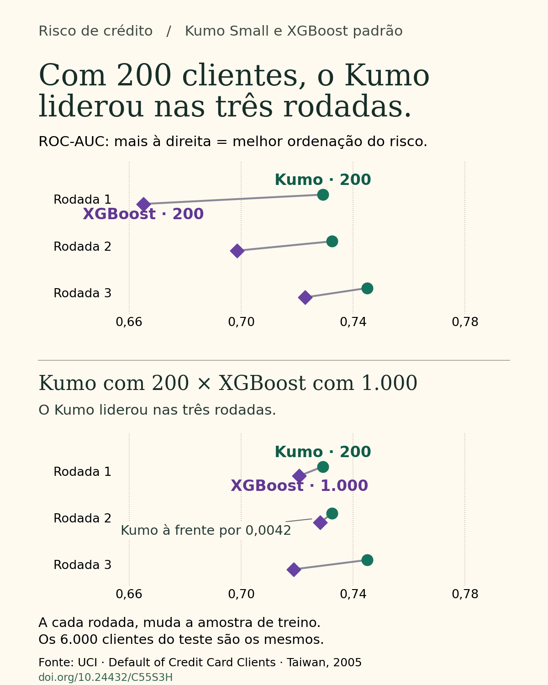

# Credit default with 200 labeled clients

**Can 200 labeled clients be enough?** A reproducible CPU benchmark of NVIDIA Kumo Small and XGBoost for credit default prediction.

This CPU experiment compares Kumo Tabular Small with 200 context rows against XGBoost with 200 and 1,000 training rows. The target is default next month in the UCI Default of Credit Card Clients dataset. ROC-AUC measures ranking. Average precision is a secondary metric.

[Results](#what-the-comparison-shows) · [Method](#regularization-follow-up) · [Reproduce](#reproduce-the-benchmark) · [Original benchmark](#original-benchmark)

## What the comparison shows

With the same 200 labeled clients, Kumo Small achieved a higher test ROC-AUC than regularized XGBoost in all three draws (means of 0.7575 and 0.7325). Expanding the XGBoost sample to include 800 additional clients raised its mean to 0.7771. It then exceeded the 200-label Kumo result in two of three draws. All scores here use the same 6,000 held-out clients. Kumo at 1,000 labels was not evaluated.



[Data source: UCI Machine Learning Repository — Default of Credit Card Clients](https://archive.ics.uci.edu/dataset/350/default+of+credit+card+clients)

[Measurements for each training draw](results/regularization/metrics.csv)

## Regularization follow-up

On a fresh holdout, XGBoost with 1,000 labels overtook Kumo with 200 after training-only hyperparameter selection. With equal budgets of 200 labels, Kumo retained the higher mean ROC-AUC.

| Model | Labels | Mean training ROC-AUC | Mean test ROC-AUC | Mean test average precision |
| --- | ---: | ---: | ---: | ---: |
| Kumo Small | 200 | — | 0.7575 | 0.5197 |
| XGBoost default | 200 | 1.0000 | 0.7175 | 0.4490 |
| XGBoost regularized | 200 | 0.9209 | 0.7325 | 0.4783 |
| XGBoost default | 1,000 | 1.0000 | 0.7424 | 0.4914 |
| XGBoost regularized | 1,000 | 0.8385 | 0.7771 | 0.5539 |

The three nested training draws are the same as in the original experiment. The new stratified test set (6,000 clients, seed 2026) excludes every previously trained or tested client and every profile matching their 23 input features. It represents the same historical period. Compare models within this table since the original table uses different test clients.

Within each training draw and budget, eight regularized XGBoost configurations competed on mean validation ROC-AUC in three stratified folds, grouping identical feature profiles. The grid combined depths 2 and 3, minimum child weights 1 and 5, and L2 penalties 5 and 20, with learning rate 0.05. Each winner was refit on its full training sample. Kumo used its original one-estimator context protocol.

Reproduce with `python -m kumo_benchmark regularization` after the setup below. [Follow-up code](kumo_benchmark/regularization.py) · [Per-draw measurements](results/regularization/metrics.csv) · [All validation scores and selected configurations](results/regularization/selection.csv)

## Dataset

I-Cheng Yeh contributed the public *Default of Credit Card Clients* dataset to UCI. It covers 30,000 credit card clients in Taiwan. The features include credit limits and billing and repayment histories from April through September 2005. The binary target records default in the following month. Download the original archive with the commands below. [Dataset documentation and attribution](https://doi.org/10.24432/C55S3H)

## Reproduce the benchmark

Clone or download this repository, open its root directory and create an isolated environment with Python 3.11. The experiments use the CPU. The first run needs internet access for the UCI archive and public Kumo Small checkpoint.

**Windows PowerShell**

```powershell
py -3.11 -m venv .venv
.\.venv\Scripts\python.exe -m pip install -r requirements.txt
.\.venv\Scripts\python.exe -m kumo_benchmark all
```

If Python 3.11 is installed outside the Windows launcher, use its full executable path for the first command.

**Linux or macOS shell**

```sh
python3.11 -m venv .venv
.venv/bin/python -m pip install -r requirements.txt
.venv/bin/python -m kumo_benchmark all
```

Use the environment's Python for each command below. The dataset command downloads the archive if missing and checks its SHA-256 before use. The other experiment commands perform the same check automatically.

| Command after `python -m kumo_benchmark` | Purpose | Output |
| --- | --- | --- |
| `data` | Fetch or verify the UCI archive | `data/uci.zip` |
| `baseline` | Run Kumo and default XGBoost on the original split | `runs/baseline/` |
| `regularization` | Select regularization on training folds and score the fresh holdout | `runs/regularization/` |
| `all` | Run both experiments in order | Both run directories |
| `verify` | Compare both local runs against the reference CSVs (absolute tolerance 0.000001, timings excluded) | Terminal report |
| `figures` | Redraw the two reference PNGs from their saved CSVs | `results/baseline/` and `results/regularization/` |

## Repository layout

| Location | Contents |
| --- | --- |
| [kumo_benchmark/](kumo_benchmark/) | Command line, verified data download, experiment implementations and figures |
| [results/baseline/](results/baseline/) | Nine original measurements and the original chart |
| [results/regularization/](results/regularization/) | Fifteen follow-up measurements, 48 validation scores and the main chart |
| [requirements.txt](requirements.txt) | Pinned Python dependencies |
| `runs/` | Metrics and figures generated on your machine. Repeating an experiment replaces its local outputs. |
| `data/`, `.hf/` | Local dataset and model cache |

After a complete run, use `python -m kumo_benchmark verify` with the environment interpreter. To inspect a difference, match metrics by model, label count and seed against the corresponding reference CSV. Compare ROC-AUC and average precision before rounding. Wall times depend on hardware. The recorded experiments ran in Windows on an Intel Core i5-1135G7.

## Original benchmark

| Model | Labeled clients | Mean ROC-AUC | Mean average precision |
| --- | ---: | ---: | ---: |
| Kumo Tabular Small | 200 | 0.736 | 0.499 |
| XGBoost | 200 | 0.695 | 0.430 |
| XGBoost | 1,000 | 0.723 | 0.471 |

With only 200 labeled clients, I would include Kumo Small in an initial credit-risk evaluation. Kumo with 200 labels ranked above XGBoost with 1,000 labels on each training draw. The paired ROC-AUC differences ranged from 0.004 to 0.026. All three draws share one test set, so these differences describe this experiment. Before selecting a model, I would check whether that advantage holds on a newer cohort.



[Data source: UCI Machine Learning Repository — Default of Credit Card Clients](https://archive.ics.uci.edu/dataset/350/default+of+credit+card+clients)

Regenerate both figures from the recorded CSV with `python -m kumo_benchmark figures`.

Inspect the [nine individual measurements](results/baseline/metrics.csv), the [experiment script](kumo_benchmark/baseline.py) and the [dependency versions](requirements.txt). Each CSV row identifies a model, label budget and training seed. The seconds column measures elapsed wall time.

Reproduce the original benchmark with `python -m kumo_benchmark baseline` after completing the [environment setup](#reproduce-the-benchmark).

### Baseline design

A stratified split with seed 42 holds out 6,000 clients. Each of three seeds (12, 36 and 53) draws 1,000 stratified training rows and a nested subset of 200. Models share the same test clients. The client ID and target are excluded from the 23 numeric input columns. Both models use the original numeric codes. Kumo caches its context with one estimator and predicts in batches of 125. XGBoost uses package defaults with four threads and a fixed seed. There is no hyperparameter search.

Elapsed wall time covers fitting or context preparation and predicting all test rows, excluding disk reads, Kumo checkpoint loading and evaluation. Measurements are single runs on an Intel Core i5-1135G7. Repetitions vary training clients while reusing one test set. The comparison is descriptive and specific to this dataset and these settings.

[UCI dataset and attribution](https://archive.ics.uci.edu/dataset/350/default+of+credit+card+clients) · [NVIDIA Kumo Tabular](https://docs.nvidia.com/sdgm/structured-data-models/models/kumo-tabular)
